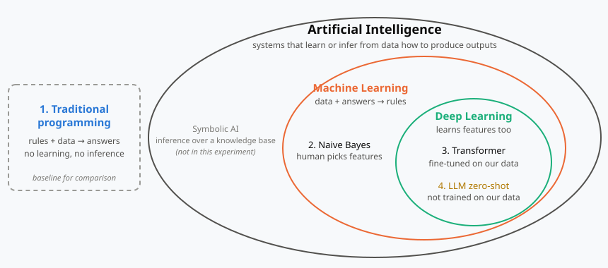
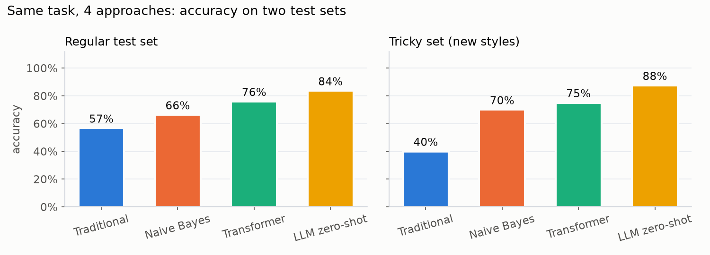

# Spam Detection Four Ways: Traditional Programming, ML, Deep Learning, LLM

[](https://colab.research.google.com/github/Intisar3/spam-rules-ml-dl-llm/blob/main/spam_detection.ipynb)

One task, one bilingual dataset (Arabic + English), four approaches. The goal is to **see** how each approach decides, by coloring the words behind each decision.



| # | Approach | Who writes the logic? | What it needs |
|---|---|---|---|
| 1 | Traditional programming | A human writes the rules (keyword list + patterns) | Domain knowledge only |
| 2 | Naive Bayes + TF-IDF (ML) | Learned from data | Labeled data + human-chosen features (words) |
| 3 | Fine-tuned Transformer (DL) | Learned from data, features too | Labeled data + pre-trained model + compute |
| 4 | LLM zero-shot | A general model, no training on our data | A task description in plain words |

Approach 1 is **not AI**: it is traditional programming (rules + data → answers), with no learning and no inference. Machine learning flips this (data + answers → rules). It is kept as a baseline to show what the learning approaches (2–4) add.

## What you see

- **Word highlighting** per approach: red = spam, blue = ham, darker = stronger.
  - Traditional programming: the words matched by the hand-written rule list.
  - Naive Bayes: `log P(word|spam) − log P(word|ham)` for every word.
  - Transformer: occlusion, removing each word and measuring how much the spam probability changes.
  - LLM: the evidence words the model reports itself (self-reported, which is a different thing from measured influence).
- **Accuracy on two sets**: a regular test set from templates never seen in training, and a hand-written *tricky set* with tactics absent from training (obfuscated spelling, Arabizi, lookalike domains, normal messages full of "spam words").
- **Scoreboard**: every tricky message against every approach, ✓ or ✗.
- **Gallery** saved to `outputs/gallery.html`.



## Run it in the cloud (no setup, no GPU needed)

Click **Open in Colab** above, then *Runtime → Change runtime type → T4 GPU*, then *Run all*. On Kaggle: *File → Import Notebook* from this repository's URL, then *Settings → Accelerator → GPU* and turn *Internet* on.

The first code cell detects Colab/Kaggle, clones this repository and installs the requirements. Before the LLM step it installs Ollama and pulls `qwen2.5:7b` (~4.7 GB). Everything is free; GPU availability and weekly hours are limited.

## Run it locally

Python 3.10 or newer (tested on 3.14).

```bash
python -m venv .venv
# Windows: .venv\Scripts\activate    macOS/Linux: source .venv/bin/activate
pip install -r requirements.txt
```

Open `spam_detection.ipynb` in VS Code or Jupyter, pick the `.venv` kernel, and run all cells.

- **Transformer**: downloads `distilbert-base-multilingual-cased` (~540 MB) on first run and trains in 3–8 minutes on a CPU. Swap `MODEL_NAME` for `aubmindlab/bert-base-arabertv02` (Arabic only) or `xlm-roberta-base`.
- **LLM**: install [Ollama](https://ollama.com), then `ollama pull qwen2.5:7b` (free, runs on your machine, no data leaves it). Or set `LLM_BACKEND = "deepseek"` with a `DEEPSEEK_API_KEY` environment variable (low-cost paid API, key from platform.deepseek.com; messages are sent to an external server).
- Set `RUN_TRANSFORMER` or `RUN_LLM` to `False` to skip either one; approaches 1 and 2 run in seconds on any laptop.

## Data

- `data/messages.csv`: 520 Arabic and English SMS-style messages (spam / ham) from 260 hand-written templates. The notebook splits by template, so no template appears in both train and test.
- `data/tricky.csv`: 40 hand-written hard cases using tactics absent from training, each with a note on why it is tricky.

The messages are synthetic, for detection research and training only. Links use reserved `.example` domains and phone numbers are fully masked. See [data/README.md](data/README.md) for the spam definition and design choices.

To change the data, edit the templates in `data/templates/` (rules in [SPEC.md](data/templates/SPEC.md)), then rebuild and check:

```bash
python data/build_dataset.py   # rebuilds both CSV files, then runs the audit
python data/audit.py           # audit only: safety, train/test leakage, shortcut features
```

## Project layout

```
spam-rules-ml-dl-llm/
├── spam_detection.ipynb    the experiment, step by step
├── src/
│   ├── text_utils.py       Arabic normalization + tokenization
│   └── highlight.py        spans → colored HTML, side-by-side view, scoreboard
├── data/
│   ├── messages.csv, tricky.csv
│   ├── templates/          hand-written templates + SPEC.md
│   ├── build_dataset.py    builds the CSV files
│   └── audit.py            automatic data audit
├── reports/                research report and data audit (Arabic)
├── assets/                 figure used above
├── outputs/                charts and gallery written by the notebook
├── requirements.txt
└── LICENSE
```

## License

Code: MIT, see [LICENSE](LICENSE). Data (`data/*.csv`, `data/templates/`): CC BY 4.0, see [data/README.md](data/README.md).

---

<div dir="rtl">

## مقارنة تجريبية لأربع تقنيات في كشف رسائل الاحتيال

مقارنة بصرية بين البرمجة التقليدية وتعلم الآلة والتعلم العميق والنموذج اللغوي الكبير في كشف رسائل الاحتيال باللغتين العربية والإنجليزية، مع تلوين الكلمات التي اعتمدت عليها كل تقنية في قرارها.

**التشغيل السحابي:** زر Open in Colab أعلى الصفحة، ثم اختيار T4 GPU وتشغيل جميع الخلايا. ويجري التجهيز تلقائيًا، دون تكلفة ودون متطلبات على الجهاز.

**التشغيل المحلي:** إنشاء بيئة افتراضية، ثم تثبيت المكتبات من `requirements.txt`، ثم فتح الدفتر وتشغيل جميع الخلايا. وتتطلب التقنية الرابعة تثبيت Ollama، أو مفتاح DeepSeek API.

**البيانات:** 520 رسالة مصطنعة من 260 قالبًا، و40 رسالة صعبة بأساليب لا تظهر في التدريب. والروابط بنطاقات محجوزة، وأرقام الهواتف مخفية بالكامل. والتفاصيل في `data/README.md`.

**الترخيص:** MIT للكود، وCC BY 4.0 للبيانات.

</div>
